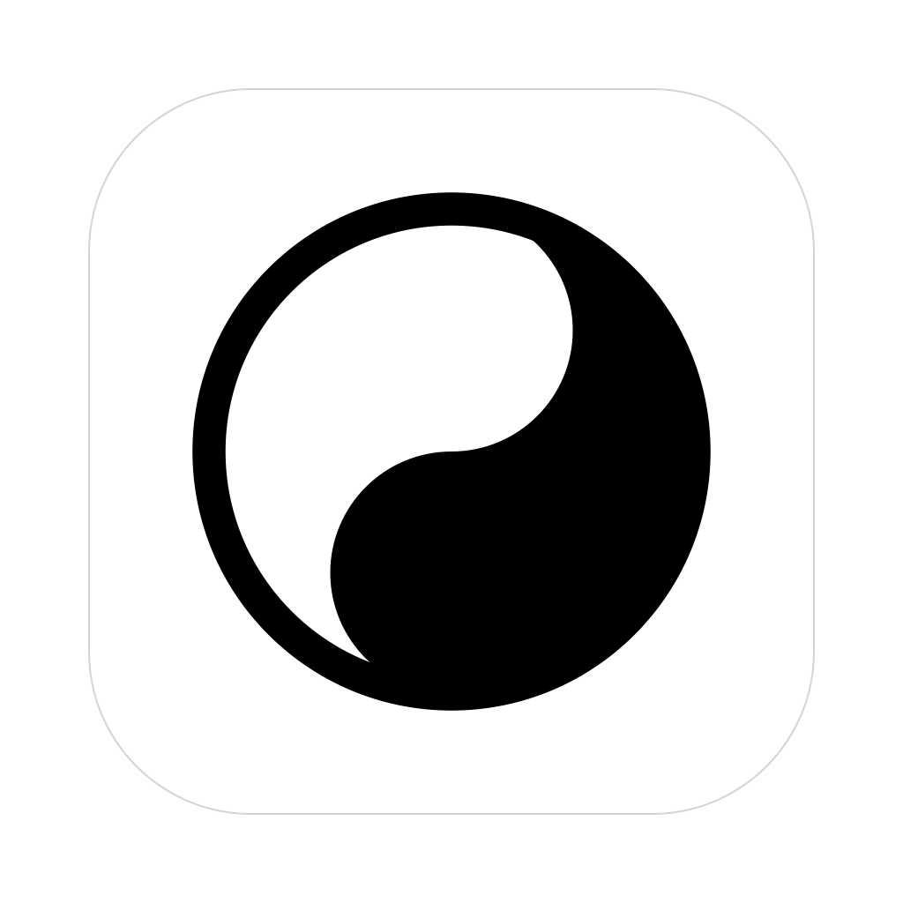

<p align="center"></p>

# ⊹╰(⌣ʟ⌣)╯⊹ ☯ Zenmark

[](https://github.com/zenmark-org/zenmd/actions/workflows/ci.yml)

**Zenmark** is a desktop markdown reader and editor for folders of markdown:
the sidebar is built from your links, pages render with plugins and layouts,
and a folder can become a website, a printed document or a course. macOS first,
built on [Wails v3](https://v3.wails.io).

Underneath is **zenmd**, the engine (format, rendering, plugins, layouts, build,
print, templates), with the command line tool `zenmd`. Zenmark is the first app
built on it ([docs/ENGINE.md](docs/ENGINE.md)).

Website: [zenmark.org](https://zenmark.org) · Code: [github.com/zenmark-org/zenmd](https://github.com/zenmark-org/zenmd) · Status: alpha, `0.4.0` (see [CHANGELOG.md](CHANGELOG.md)).

© 2026 Zenmark Studios. All rights reserved; the code is proprietary ([LICENSE](LICENSE)).

## Quick start

Requires macOS 13+, Go 1.26+, Node 22+, the Wails CLI and Task:

```sh
go install github.com/wailsapp/wails/v3/cmd/wails3@v3.1.0
go install github.com/go-task/task/v3/cmd/task@latest
```

```sh
git clone https://github.com/zenmark-org/zenmd && cd zenmd
task build            # frontend, runtime and bin/zenmd
task install          # links zenmd (and the old name zen) into ~/.local/bin
zenmd examples/demo   # open the user guide, which shows every feature
```

To get the app bundle:

```sh
task package                                # bin/Zenmark.app, as apps/zenmark/app-assembly.yml lists (Vale is downloaded once, checksum-checked)
task package ADDONS=                        # the same without add-ons
ditto bin/Zenmark.app /Applications/Zenmark.app
INSTALL_DIR=~/.local/bin task install:cli   # point zenmd at the installed app instead
```

A local `task package` is ad-hoc signed and is for this Mac. Releases are signed
with a Developer ID and notarised by Apple, so they open without the "could not
verify" warning: `task darwin:sign:notarize` (see [docs/DISTRIBUTION.md](docs/DISTRIBUTION.md)).

## Everyday commands

| Command | What it does |
|---|---|
| `task build` | Build the frontend, the runtime and `bin/zenmd` |
| `task dev` | Run the app with live reload |
| `task test` | Go and frontend tests (what CI runs) |
| `task package` | `bin/Zenmark.app` (Developer ID channel, ad-hoc signed) |
| `task package:appstore` | The sandboxed Mac App Store build (needs Xcode and an Apple account) |
| `task install` / `task uninstall` | Link `zenmd` to the development build in `~/.local/bin` |
| `task install:cli` | Link `zenmd` to an installed `Zenmark.app` |
| `task release` / `task release:publish` | The notarised universal DMG for `VERSION`, and its upload to the GitHub release (a `v*` tag does both in CI) |
| `task api:check` | Check the engine's Go API against the last tag (`apidiff`) |
| `task version` | Print the version |

## The `zenmd` command

```sh
zenmd [folder|file.md]                 # open in the app
zenmd edit page.md                     # open in the editor
zenmd export site [folder] [-o dir]    # a static website (portable by default; --hosted for a web server); zenmd build is the same
zenmd export pdf [folder] [-o file]    # the whole folder as one PDF (macOS)
zenmd init site --techdocs [folder]    # start a folder from a template (--learning, --planner)
zenmd version
```

## Layout

```
engine/ builtins/ runtime/   zenmd: the engine, its built-in plugins/layouts/templates, the browser runtime (@zenmd/runtime)
kit/desktop  kit/ui          the shared desktop shell: Go (windows, dialogs, print, Run) and TypeScript (@zenmd/kit)
apps/zenmark               Zenmark itself: menu, the Zen service, its dialogs, and its frontend
build/                       packaging (macOS, Wails)
main.go                      the zenmd binary
examples/demo                the user guide
```

Imports point down: apps, then kit, then engine.

## Documentation

| | |
|---|---|
| [docs/ENGINE.md](docs/ENGINE.md) | The engine, the kit and the apps; the engine roadmap |
| [docs/PLAN.md](docs/PLAN.md) | Architecture and the service API between Go and the frontend |
| [docs/PLUGINS.md](docs/PLUGINS.md) | Writing plugins: Go, external programs, Tengo scripts, page scripts |
| [docs/LAYOUTS.md](docs/LAYOUTS.md) | Writing layouts: templates, CSS, scripts |
| [docs/TEMPLATES.md](docs/TEMPLATES.md) | Site templates for `zenmd init` |
| [docs/BUILD.md](docs/BUILD.md) | Static websites and `print.html` |
| [docs/DISTRIBUTION.md](docs/DISTRIBUTION.md) | Signing, notarisation, the DMG and the Mac App Store |
| [docs/VERSIONING.md](docs/VERSIONING.md) | SemVer for the app, the engine, plugins and config |
| [docs/UI.md](docs/UI.md) | The design system |
| [specs/README.md](specs/README.md) | Every feature spec, its wave and status |
| [examples/demo](examples/demo/README.md) | The user guide, as a zen folder |

## How work is done

Every feature starts as a spec in `specs/<scope>/<feature>/spec.md`, made from
[the template](specs/_template/spec.md). It covers behaviour, interfaces,
tests, UI, security and a prompt for whoever builds it. Each spec is then built
on its own branch (`feature/<scope>-<feature>`) in a git worktree, tests first,
and merged when the checks pass. In Claude Code, `/add-spec <scope>/<feature>`
does this ([.claude/skills/add-spec](.claude/skills/add-spec/SKILL.md)).
Bugs and ideas go to [GitHub issues](https://github.com/zenmark-org/zenmd/issues);
`/add-issue <notes>` drafts them from a list and files them after one confirmation
([.claude/skills/add-issue](.claude/skills/add-issue/SKILL.md)).
Notes from testing go in [docs/improve](docs/improve/README.md); `/check-feedback`
turns them into issues ([.claude/skills/check-feedback](.claude/skills/check-feedback/SKILL.md)).
`/work-issues` ranks the open issues and gives each one its own subagent and
worktree, then merges them in order after review
([.claude/skills/work-issues](.claude/skills/work-issues/SKILL.md)).

## Remaining work

| What | Where | State |
|---|---|---|
| Format spec and conformance tests, `zenmd check` | engine wave E3 in [docs/ENGINE.md](docs/ENGINE.md) | to specify |
| Hardening: fuzzing, performance budgets, error codes | engine wave E3 | to specify |
| `zenmd serve`, a live preview for other editors | engine wave E4 (optional) | to specify |
| Signed releases from CI: add the GitHub secrets, then the first tagged release | [docs/DISTRIBUTION.md](docs/DISTRIBUTION.md#signing-in-ci-once) | workflow ready; needs the secrets (owner) |
| Mac App Store build: wire the plugin gate, folder bookmarks, CLI refusal; `Assets.car` | [specs/packaging/appstore](specs/packaging/appstore/spec.md) | in progress; needs full Xcode and owner decisions |
| A second app on the engine (language learning: speech, glosses, flashcards) | [docs/ENGINE.md](docs/ENGINE.md) | idea |
| More plugins and layouts | [docs/possible-plugins.md](docs/possible-plugins.md), [docs/possible-layouts.md](docs/possible-layouts.md) | ideas |
