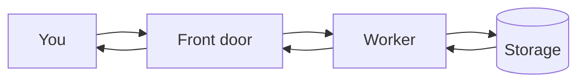

# How it works

This page explains how {{title}} is put together, and why. It does not tell you
what to do; for that, see the [how-to guides](../how-to/index.md).

*This page is an example. Replace it with the ideas behind your project.*

## The big picture

A diagram often says more than a paragraph. This one shows a request passing
through three parts:

The front door checks the request. The worker does the job, and storage keeps
the result.

## Why it is split this way

Each part has one job, so each can change on its own. The price is a few more
moving parts to learn about; the benefit is that a failure points to one place.

## Other approaches

Say what else was possible, and why it was not chosen. A fair comparison helps
readers trust the rest of the page.

## Where to go next

The exact names and defaults are in the [reference](../reference/settings.md).
