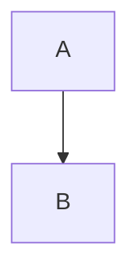

# zen — plugin system

A plugin is a *part* of a page. The look of the *whole* page is a **layout**, a
separate concept with its own folder and settings: see [LAYOUTS.md](LAYOUTS.md).
Plugins can no longer declare layouts.

Plugin API version: **1** (`apiVersion: 1`). Implemented by
`specs/core/plugins`; built-ins live in `internal/plugins/<id>`.

## What a plugin can do

A plugin takes part in the Go render pipeline (see PLAN.md). It can:

| Hook | Go interface | Use |
|---|---|---|
| source | `SourceHook` | rewrite markdown before parsing (includes, variables) |
| block | `BlockHook` | render a named fenced or container block (diagram, poll) |
| inline | `InlineHook` | render a named inline directive (badge, icon) |
| html | `HTMLHook` | rewrite the final HTML before sanitising (table of contents) |
| assets | `AssetProvider` | ship CSS/JS files served at `/_plugins/<id>/…` and loaded only on pages that use the plugin |
| action | `ActionHook` | answer a request from the plugin's own frontend (`ctx.invoke`): JSON in, JSON out |
| stream | `StreamHook` | send output over time to the plugin's frontend (`ctx.stream`): a build log, a running program |

Everything a plugin emits goes through the sanitiser. A plugin that needs
elements or attributes beyond the base policy declares them in its manifest.

```go
package plugins

const APIVersion = 1

type Manifest struct {
    ID          string            // "diagram"; [a-z][a-z0-9-]*
    Version     string            // SemVer of the plugin
    APIVersion  int
    Description string
    Default     bool              // enabled when no config mentions it
    Blocks      []string          // block names it owns: "mermaid", "diagram"
    Inlines     []string          // inline names it owns
    Allow       []AllowRule       // extra sanitiser rules: element + attributes
    Config      map[string]Option // option name -> type, default, description, scope
    Help        Help              // summary and snippets shown in Settings › Plugins (see "Help")
}

type Help struct {
    Summary  string    // at most 500 characters
    Snippets []Snippet // at most 8
}
type Snippet struct{ Title, Markdown string } // Markdown at most 4 KB: how to use the plugin in a page

type Plugin interface{ Manifest() Manifest }

type Context struct {
    Path      string         // workspace-relative path of the page
    Config    map[string]any // this plugin's effective options for this page
    DataDir   string         // the plugin's writable folder (actions and streams; same place as ZEN_DATA_DIR)
    Workspace string         // root of the open folder (actions and streams)
    Markdown  func(src string) (string, error) // renders markdown through the page's own pipeline (nested plugins, at most 8 levels deep); nil without a page pipeline
}

type Block  struct{ Name, Body string; Attrs map[string]string; Fenced bool }
type Inline struct{ Name, Text string; Attrs map[string]string }

type SourceHook    interface{ Source(ctx Context, src []byte) ([]byte, error) }
type BlockHook     interface{ RenderBlock(ctx Context, b Block) (string, error) }
type InlineHook    interface{ RenderInline(ctx Context, i Inline) (string, error) }
type HTMLHook      interface{ HTML(ctx Context, html string) (string, error) }
type AssetProvider interface{ Assets() fs.FS; Entry() Assets } // Assets{CSS, JS []string}

// For the plugin's frontend (see "Frontend" below). Built-in plugins use the same ctx as external ones.
type ActionHook interface {
    Action(ctx Context, payload []byte) ([]byte, error)
}
type StreamHook interface { // emit is called in order; return when done; stop when c is cancelled
    Stream(c context.Context, ctx Context, payload []byte, emit func(chunk []byte)) error
}
```

`Option.Type` is `string`, `bool`, `int`, `map` (names to strings, a
`map[string]string`) or `list` (strings, a `[]string`). An option with
`Scope: "user"` is read from the user's global `config.yml` only; the same
option in `.zenmd.yml` or frontmatter is ignored with a page warning. Use it for
anything a folder must not be able to widen, such as the container images a
sandbox plugin may run.

A built-in plugin that implements `ActionHook` or `StreamHook` can be called
from its frontend like an external one, as long as it is switched on.

A hook error never breaks the page: the block is replaced by an error box
(`<div class="zen-plugin-error">`) naming the plugin and the message.

## Syntax in markdown

Three forms, all resolved by name in the registry. An unknown or disabled
name falls back to plain rendering (a normal code block, or the literal text).

**Fenced block** — content is raw text, not markdown:

````markdown

````

**Container block** — content is markdown, may nest:

```markdown
:::slides{transition=fade}
# First slide
---
# Second slide
:::
```

**Inline directive:**

```markdown
Status: :badge[stable]{color=gray}
```

Attributes are `{key=value key2="two words" flag}`; a bare `flag` is `"true"`.
Names match `[a-z][a-z0-9-]*`. A colon not followed by a registered name is
left untouched, so normal prose (`note: this`) is never affected.

### Other syntaxes (dialects)

A folder can turn on a **dialect**, another way to write the same containers, in
`.zenmd.yml` (`markdown: { dialects: [myst] }`); off by default. With `myst`,
```` ```{note} Title ```` and `:::{note} Title` mean `:::note{title="Title"}`,
`:key: value` lines at the top become attributes, and `{code-block} lang` is a
highlighted code block. A plugin answers to MyST names (`tip`, `important`, …) by
listing them in `blocks`. An app reads only the dialects in its build
(`dialects:` in `app-assembly.yml`). See specs/engine/dialects.

## Enabling, disabling, configuring

Order of precedence, last wins:

1. Plugin default (`Manifest.Default`, option defaults)
2. Global config — `<user config dir>/zen/config.yml`
   (macOS: `~/Library/Application Support/zen/config.yml`)
3. Workspace config — `.zenmd.yml` in the opened folder
4. Page frontmatter

```yaml
# config.yml or .zenmd.yml
version: 1
plugins:
  codeblock: true                 # on, default options
  diagram: { theme: neutral }     # on, with options
  slides: false                   # off
```

```markdown
---
title: Architecture
plugins:
  diagram: false          # off for this page only
  codeblock: { style: github }
---
```

The global `config.yml` (only) can also raise or lower the folder limits:

```yaml
limits:
  files: 5000       # markdown files (default 2000, max 100000)
  entries: 200000   # files and folders scanned (default 50000, max 5000000)
  openTimeout: 60   # seconds reading and indexing may take (default 30, max 600)
```

A `limits` key in `.zenmd.yml` is ignored with a warning, so a folder cannot
lift its own limits.

Prose linting (Vale) is on by default when Vale is available. Turn it off for a
page, a folder or everywhere with the reserved switch `lint` (no warning):

```yaml
plugins:
  lint: false
```

A `.vale.ini` in the folder replaces zen's default Vale config (spelling plus
Vale's built-in rules).

Pages can also tune their place in the navigation:

```markdown
---
slug: install                 # extra link target: [x](install), [x](/install#part)
nav:
  title: Setup                # label in the sidebar and breadcrumb (page heading unchanged)
  order: 2                    # position among siblings; ordered pages come first, ascending
  parent: guides/index.md     # show under this page (workspace path or slug)
  hidden: true                # leave out of the sidebar (still reachable by links)
---
```

- `slug`: lower-case letters, digits and `-`, parts separated by `/`, at most 100
  characters. A slug link resolves only when no real file matches. If two pages
  use the same slug, the first by path keeps it.
- `nav.parent` overrides the link-based placement. A missing parent, the page
  itself, or a parent that would create a cycle is ignored with a warning.
  Children of a hidden page are hidden too, unless they set their own `nav.parent`.
- Pages without these keys are placed by links as before. Invalid values are
  ignored and shown as page warnings.

`true` / `false` switch a plugin; a mapping switches it on and sets options.
Unknown plugin ids and unknown options produce a warning in the page
(`Page.warnings`), never an error.

## Built-in plugins

| ID | Version | Blocks | What it does |
|---|---|---|---|
| `codeblock` | alpha | none (HTML hook over every `pre > code`) | syntax colouring in Go (chroma, CSS classes only), plus Copy and Wrap buttons in each block |
| `diagram` | alpha | `mermaid`, `diagram` | emits a placeholder; a vendored mermaid script renders it in the page |
| `polls` | 0.2 | `poll` | renders a list as a poll |

## Writing your own plugin (external plugins)

There are two ways, and the first is the simplest:

| | Made of | Use it for |
|---|---|---|
| **script plugin** | one Tengo file, run by zen inside the app | turning a block, an inline or a page into HTML; no process, no environment variables |
| **folder plugin** | a folder with a `plugin.yml`: a program zen runs, scripts and styles for the page, or both | wrapping tools that already exist (`bc`, `dot`, `container`), interactive blocks |

zen looks in two places:

| Where | For |
|---|---|
| `<folder>/.zen/plugins/` (`<id>.tengo`, `<id>/plugin.tengo` or `<id>/plugin.yml`) | plugins that travel with a folder of documents |
| `<user config dir>/zen/plugins/` (macOS: `~/Library/Application Support/zen/plugins/`) | your own plugins, for every folder |

### Script plugins (Tengo)

A script plugin is one file, written in [Tengo](https://github.com/d5/tengo)
(`github.com/d5/tengo/v2`, a small Go-like language): `.zen/plugins/note.tengo`,
or `.zen/plugins/note/plugin.tengo` with other files beside it. zen compiles it
once per content, runs a fresh copy for every call, and gives it a hard time
and allocation budget and nothing else: **no files, no programs, no network**,
unless the plugin asks for the `read` permission, and then only the markdown
and text files of the open folder.

```go
// .zen/plugins/note.tengo
plugin := {
    version: "0.1.0",
    description: "Callout boxes",
    blocks: ["note", "warning"],
    css: "div.note { border-left: 3px solid; padding: .5em 1em }"   // optional inline CSS
}

if hook == "block" {
    title := attrs.title || (name == "warning" ? "Warning" : "Note")
    out = zen.html("div", {class: name}, zen.html("div", {class: "callout-title"}, zen.html("strong", {}, title)), zen.markdown(body))
}
```

The id is the file name (or the folder name of the folder form): `[a-z][a-z0-9-]*`.
zen first runs the script once with `hook == ""` to read the top-level `plugin`
map, which must be there. After that each hook call runs the whole script again
on a fresh copy, so nothing is kept between calls except through `zen.storage`.
Everything a script returns is sanitised like all plugin output; a script plugin
has no `allow` rules, so it works with the base HTML policy.

**The `plugin` map.** An unknown key is an error.

| Key | |
|---|---|
| `version` | required, SemVer |
| `description` | text for Settings and the trust prompt |
| `blocks`, `inlines` | the names it owns (`[a-z][a-z0-9-]*`); `blocks` gives the `block` hook, `inlines` the `inline` hook |
| `hooks` | more hooks, any of `source`, `html`, `action` (and `block`/`inline` when the names are listed) |
| `permissions` | `[]` or `["read"]`, nothing else exists |
| `timeout` | a duration string such as `"500ms"`; default `"200ms"`, at most `"2s"` |
| `css` | inline CSS (at most 64 KB; no `@import`, no web addresses, `url()` only for `data:` images), served as `/_plugins/<id>/inline.css` and loaded on pages that use the plugin |
| `options` | `{name: {type, default, description, scope}}` as in `plugin.yml`; they arrive in `config` |
| `default` | `false` to start switched off |
| `help` | `{summary: "…", snippets: [{title: "…", markdown: "…"}]}`, see "Help" below |
| `js`, `stylesheets` | folder form only: page scripts (ES modules with a default export, as in "Frontend") and style sheets beside the script |

**Globals.** Every call sees these; the script assigns `out`.

| Global | Value |
|---|---|
| `hook` | `"block"`, `"inline"`, `"source"`, `"html"`, `"action"`, or `""` while zen reads the `plugin` map |
| `name` | the block or inline name; `""` for the others |
| `body` | the block's body (raw text), the inline's text, the page's markdown (`source`) or HTML (`html`) |
| `attrs` | the `{key=value}` attributes (a map of strings) |
| `config` | the plugin's options for the page |
| `page` | `{path, title}` of the page (the title is the frontmatter's, else the first heading, else the file name) |
| `payload` | `action` only: the JSON sent by `ctx.invoke`, decoded (`undefined` otherwise) |
| `out` | the result: a string or a `zen.html` result; for `action` any value (maps, lists, numbers, strings), sent back as JSON. Left unset, a block or inline is empty, `source` and `html` leave the text alone and an `action` answers `null` |

**The `zen` module** is a Go-built map of functions, the only API a script has.

| Function | Does |
|---|---|
| `zen.escape(s)` | `s` with `& < > " '` escaped (a string) |
| `zen.html(tag, attrs, children...)` | the element as an html value. The tag and attribute names are checked; attribute values and string children are escaped; children that are `zen.html` / `zen.markdown` results are kept as HTML; lists are flattened; `true` is a bare attribute, `false` and `undefined` leave it out; void tags (`br`, `img`, …) take no children |
| `zen.markdown(s)` | renders markdown through the page's own pipeline (nested plugins included, their assets with it, at most 8 levels deep) and returns an html value |
| `zen.storage.get(key)` | the value kept under `key`, `undefined` for none |
| `zen.storage.set(key, value)` | keeps any JSON value; the same store, limits (1 MB per plugin and folder) and file as `ctx.storage` |
| `zen.storage.keys(prefix)` | the stored keys that start with `prefix`, sorted |
| `zen.read(path)` | **`read` permission.** The text of a file of the open folder, `undefined` when it is not there |
| `zen.pages()` | **`read` permission.** The folder's pages as a list of `{path, title}`, sorted by path |

`zen.read` opens `.md`, `.markdown`, `.txt`, `.text`, `.csv`, `.tsv`, `.json`,
`.yml` and `.yaml` files only, regular files of at most 1 MB that are valid UTF-8
and that stay inside the open folder: an absolute path, a `..` that leaves it,
or a symlink that resolves outside is refused. Other modules cannot be
imported except the pure standard ones, `text`, `math`, `times`, `fmt`,
`json`, `enum`, `base64`, `hex` and `rand`; `times.sleep` and `fmt.print*` are
removed (one cannot be interrupted, the others write to zen's own output).
Any other `import` (`os`, a file) fails when the plugin loads, and a plugin
that fails to compile, run once or validate is listed as invalid with the line
and the problem.

**Limits, per call.** A script that goes over one stops and the page shows
the plugin's error box in place of the block.

| Limit | Value | Error |
|---|---|---|
| wall time | 200 ms, or `timeout` up to 2 s | `timed out after 200ms` |
| allocations | 500 000 objects (every number or string a script makes counts) | `allocation limit exceeded` |
| memory | the heap may grow by 256 MB during a call (a list doubled 30 times costs few objects and gigabytes) | `memory limit exceeded` |
| strings and bytes | 4 MB each | `a string or bytes value is larger than 4 MB` |
| output | 2 MB | `the output is larger than 2 MB` |
| script file | 256 KB | the plugin is invalid |

Calls are cancelled when the folder changes or zen quits, like a program's. The wall time counts everything the call waits for, `zen.markdown` included.

**Trust** is the one of folder plugins, below: the same discovery, hash (of the
`.tengo` file, or of the whole folder in the folder form), fingerprint check
before every call and asset, per-workspace answer and `plugins:changed`. A
script plugin is always asked about, but the prompt says what it can do:
"renders blocks inside zen; cannot read files, run programs or use the network",
and with `read`, "renders blocks inside zen and reads files in this folder;
cannot run programs or use the network". A single `.tengo` file must be a plain
file, not a symlink. `Plugins()` (Settings › Plugins) reports `kind: "script"`
for them, `"program"` or `"page"` for folder plugins and `"builtin"` for the
built-in ones.

**Isolation.** Scripts do not run inside the zen process. Tengo values are
references, so a script can build a map or list that contains itself
(`m := {}; m.self = m`), and Tengo's own `string(m)`, `m == m2`, `copy(m)` and
`"text" + m` then recurse until the Go stack overflows, a fatal error nothing
can catch. Run in the app, that would stop zen and lose unsaved text. So zen
runs every script in a **helper process**: the same zen binary started as the
hidden `zen __script-host` (it refuses to run on a terminal), a small pool of
long-lived helpers (2, up to 4 computing at once) started on first use. A
helper gets only `PATH`, `HOME`, `TMPDIR` and `LANG`, a private temporary
working folder, and no files of its own: whatever a script reaches
(`zen.markdown`, `zen.storage`, `zen.read`, `zen.pages`) is a request to zen,
which checks the permission and the path rules and answers. Your scripts do not
change; a call costs about 0.1 ms once the helper is warm.

- A script that overflows the stack, or a helper that dies for any other
  reason, ends that call with the error box "the script plugin crashed"; the
  helper is replaced and the next call, of the same or another plugin, runs
  normally.
- A script stopped by the time limit or the memory limit is stopped by killing
  its helper too (Tengo cannot interrupt a builtin such as `string(m)`), and a
  helper over 512 MB is killed by zen.
- Three crashes of the same plugin within a minute switch it off until zen is
  restarted or the script is edited; its blocks show "the script plugin was
  switched off after 3 crashes in a minute". There is no restart loop.
- Helpers end when the folder changes (a call in progress finishes first) and
  when zen quits.

### Folder plugins

A plugin can have any mix of three parts:

| Part | What it is | Use it for |
|---|---|---|
| **backend** | any program (script or binary) zen runs when a page renders | turning a block into HTML, calling a tool (`dot`, `bc`, `container`) |
| **frontend** | JavaScript and CSS loaded on pages that use the plugin | interactive blocks, anything that reacts to clicks |
| **tool** | a backend whose command is an existing program on the Mac | no code at all: the block's text is its input, its output is shown |

#### plugin.yml

```yaml
id: note                      # [a-z][a-z0-9-]*, must equal the folder name
version: 0.1.0                # SemVer
apiVersion: 1
description: Callout boxes
default: true                 # on unless config switches it off (also when omitted)

blocks: [note, warning]       # ```note fences and :::note containers
inlines: [badge]              # :badge[text]{attrs}

options:                      # read from config / frontmatter `plugins.note.*`
  icon: { type: bool, default: true, description: Show an icon }
  images: { type: map, scope: user }   # map (string to string) and list (strings) are also types;
                                       # scope: user = only the global config.yml may set it

allow:                        # extra HTML the sanitiser keeps for this plugin
  - { element: div, attrs: [class] }

help:                         # shown in Settings › Plugins (optional, see "Help")
  summary: Callout boxes, a note or a warning.
  snippets:
    - title: A note
      markdown: |
        :::note{title="Remember"}
        Text.
        :::

backend:
  command: ["./note.sh"]      # relative to the plugin folder, or a program on PATH
  hooks: [block, inline]      # any of: source, block, inline, html, action, stream
  output: html                # html (default) or text (escaped and shown in <pre>)
  timeout: 5s                 # default 5s, at most 60s; with the stream hook: default 60s, at most 10m

frontend:
  js: [note.js]               # ES modules with a default export, loaded only on pages that use the plugin
  css: [note.css]
```

#### Help

A plugin can describe itself. Settings › Plugins shows the help next to the
plugin: the `summary`, what the plugin adds (its blocks, inlines and
options, which zen reads from the manifest), and every snippet with a Copy
button. Built-in plugins also get a rendered preview of each snippet; external
plugins show the snippet only. `help` is optional, and the same in `plugin.yml`
and in the Tengo `plugin` map (`help: {summary: "…", snippets: [{title: "…",
markdown: "…"}]}`):

| Key | Rule |
|---|---|
| `summary` | text, at most 500 characters |
| `snippets` | at most 8; each has a `title` and the `markdown` to copy, at most 4 KB |

Any other key, or a snippet without a title or markdown, rejects the plugin.
Write snippets a reader can paste into a page as they are. A snippet that
starts with frontmatter (a layout, or options for a page) is a whole page and
gets no preview. Changing `help` changes the folder, so zen asks again before
it uses the plugin (see Trust). The service call `Plugins()` returns the help
as `help: {summary, snippets: [{title, markdown}]}` with `blocks`, `inlines`,
and `options: [{name, type, default, description}]`.

### Backend: one program, plain input and output

zen starts `command` once per call, in the plugin folder, with **input on
stdin**, the **result on stdout**, and everything else in environment
variables. Exit code 0 means success; anything else shows stderr in an error
box in place of the block (the page still renders).

| `ZEN_HOOK` | stdin | stdout |
|---|---|---|
| `block` | the block's body (raw text) | HTML for the block |
| `inline` | the text in `[...]` | HTML for the span |
| `source` | the page's markdown | markdown |
| `html` | the page's HTML | HTML |
| `action` | JSON sent by the plugin's frontend (`ctx.invoke`) | JSON returned to it |
| `stream` | JSON sent by the plugin's frontend (`ctx.stream`) | forwarded to the frontend line by line, as it is printed |

A `stream` call ends when the program exits: exit code 0 is success, anything
else is reported to the frontend with the first lines of stderr. It is cut at
4 MB of output (error `output limit`), when its timeout passes, when the
frontend cancels it (the whole process group is killed) and when the folder
changes or zen quits, or when the plugin is blocked or switched off. Output
reaches the frontend in batches: at most one `plugin:stream` event per call
every 50 ms, its `chunk` the lines printed since the last event joined with
`\n` (no trailing newline; an empty line is an empty piece). The 4 MB limit
counts every line once, its newline and empty lines included. At most 4
streams run at once. `timeout` for a plugin
with the `stream` hook is the stream's limit; its other hooks keep the 60 s
cap.

| Variable | Value |
|---|---|
| `ZEN_HOOK`, `ZEN_PLUGIN`, `ZEN_API` | hook name, plugin id, `1` |
| `ZEN_NAME` | block or inline name (`note`) |
| `ZEN_FENCED` | `1` for a ``` fence, `0` for a `:::` container |
| `ZEN_PAGE` | page path inside the folder (`guides/install.md`) |
| `ZEN_ATTR_<KEY>` | each `{key=value}` attribute, key upper-cased, anything but `A-Z 0-9 _` → `_`. When two names give the same variable (`a-b` and `a_b`) only one entry is set: the name that sorts last wins. The `*_JSON` variables always carry every name |
| `ZEN_ATTRS_JSON`, `ZEN_CONFIG_JSON` | all attributes / this plugin's options as JSON |
| `ZEN_CONFIG_<KEY>` | each option (a `map` or `list` as JSON) |
| `ZEN_WORKSPACE`, `ZEN_PLUGIN_DIR`, `ZEN_DATA_DIR` | folder root, plugin folder, a writable data folder for this plugin |

The environment is otherwise minimal (`PATH`, `HOME`, `TMPDIR`, `LANG`). Output
is capped at 2 MB. Whatever the program prints is sanitised like all HTML.

**Limits.** One deadline (`timeout`) covers the program *and* its output pipes:
when it passes, or the folder changes, or zen quits, the process group is
killed and the call fails with `timed out` or `cancelled`. A child that leaves
the process group and keeps stdout open until the deadline makes the call time
out too (output is never reported as complete when it may be cut).

**`PATH`.** An app started from the Finder has a short `PATH`. zen adds
`/opt/homebrew/bin`, `/usr/local/bin`, `/opt/local/bin`, `~/.local/bin` and
`~/.cargo/bin` after the usual system folders. A tool anywhere else (nvm,
pyenv, a custom prefix) is reached by its absolute path in a script of the
plugin folder, e.g. `exec "$HOME/.nvm/versions/node/v22/bin/node" run.js`.

**Where files may point.** A plugin folder holds regular files, folders and
symlinks that resolve to a file inside it. A symlink out of the folder, a
pipe, socket or device, `command` as an absolute path, or an argument that
names an existing file outside the folder (`["sh", "../x.sh"]`) rejects the
plugin ("outside the plugin folder"); `plugin.yml` is read only from inside the
folder, at most 256 KB. At most 500 files and 20 MB.

A whole plugin in a shell script:

```sh
#!/bin/sh
# .zen/plugins/note/note.sh — renders :::note{title="..."} containers
title="${ZEN_ATTR_TITLE:-Note}"
printf '<div class="note"><strong>%s</strong>' "$title"
sed -e 's/&/\&amp;/g' -e 's/</\&lt;/g'      # body from stdin, escaped
printf '</div>'
```

A **tool** plugin needs no code. This one evaluates ```` ```calc ```` blocks with `bc`:

```yaml
id: calc
version: 0.1.0
apiVersion: 1
blocks: [calc]
backend: { command: ["bc", "-l"], hooks: [block], output: text }
```

### Frontend: an ES module with a default export

Every block or inline a plugin owns is wrapped by zen:

```html
<div data-zen-plugin="quiz" data-zen-name="quiz" data-zen-attrs='{"id":"q1"}'> … </div>
```

Inside is the backend's HTML or, for a plugin without a `block` hook, the
content itself: a `:::` container's markdown rendered to HTML, or a fence's
text in `<pre class="zen-plugin-source">`. The plugin's script is an ES module
whose default export is the plugin; zen loads it with `import()`, binds it to
the plugin's id and calls `mount` for each of that plugin's wrappers, again
after every re-render. (`zen.register` no longer exists; `window.zen` is a
frozen `{ version: 2 }`.) Built-in plugins use the same form:

```js
// .zen/plugins/counter/counter.js
export default {
  async mount(el, ctx) {
    let n = (await ctx.storage.get("count")) ?? 0;
    const b = document.createElement("button");
    const draw = () => (b.textContent = `Clicked ${n} times`);
    b.onclick = async () => { n++; draw(); await ctx.storage.set("count", n); };
    draw();
    el.replaceChildren(b);
    return () => b.remove();          // optional clean-up
  },
};
```

A module without a default `mount` shows an error box naming the plugin. The
URLs of a plugin's files end in `?v=<version>` (the first 12 hex digits of
the approved hash for an external plugin, the app version for a built-in), so
a changed plugin loads under a new URL; after a trust change or an edit zen
unmounts every plugin and mounts again from the current page (`plugins:changed`).

| `ctx` | |
|---|---|
| `ctx.id`, `ctx.kind`, `ctx.name` | plugin id; `"block"` or `"inline"`; the block name |
| `ctx.attrs` | the `{key=value}` attributes |
| `ctx.page` | `{ path, title }` |
| `ctx.storage.get(key)` / `.set(key, value)` | JSON values kept per plugin and per folder, on this Mac (1 MB per plugin) |
| `ctx.storage.keys(prefix?)` | the stored keys (starting with `prefix`), sorted |
| `ctx.invoke(payload)` | runs the backend with `ZEN_HOOK=action`; resolves to the JSON it prints. zen resolves the plugin's on/off state and options for the page the block is on (`ctx.page.path`), and `ZEN_PAGE` is that page |
| `ctx.stream(payload, onChunk)` | runs the backend with `ZEN_HOOK=stream` (or a built-in's `StreamHook`); `onChunk(line)` gets each line in order (the page splits zen's batches). Returns `{ done, cancel() }`: `done` resolves when it ends and rejects with the error text (`cancelled` after `cancel()`). Streams a block started are cancelled when it unmounts |
| `ctx.navigate(path, anchor?)` | open another page |
| `ctx.anchor()` | the current page's anchor (`""` when none) |
| `ctx.onAnchor(fn)` | `fn(anchor)` when the anchor changes without a reload (a link to another heading of the same page); returns a remover; removed on unmount |
| `ctx.badge(path, text)` | sets a short label (12 characters at most; `null` clears) shown muted after that page's title in the sidebar, until the window closes |
| `ctx.assetUrl(file)` | the URL of another file the plugin ships but does not list in `js`/`css` (a bundle it loads lazily, data, images). Works in the app and in a site made by `zenmd build` |

```js
// stream a log into a <pre>
const log = document.createElement("pre");
el.replaceChildren(log);
const run = ctx.stream({ target: "build" }, (line) => log.append(line + "\n"));
run.done.catch((err) => log.append(`stopped: ${err.message}\n`));
```

Print: File › Print… (⌘P) prints the open page; zen hides the sidebar, header
and panels and uses the full page width. A plugin can add its own rules in an
`@media print` block of its CSS (for instance one slide per sheet).

### Look and feel: the plugin kit

Every interactive block looks the same: a frame, a title row, buttons, option
rows and text fields come from the plugin kit, which zen ships on every page. Add
its classes to your elements and style only what is your own. The classes and the
rules for plugins and layouts are in [PLUGIN-UI.md](PLUGIN-UI.md).

### Layouts are not plugins

A `layouts:` key in `plugin.yml`, or in a Tengo `plugin` map, is an error that
names the new place, `.zen/layouts/<id>/layout.yml`. See [LAYOUTS.md](LAYOUTS.md).

### Trust

Plugins run programs and scripts, so **zen asks before using a plugin for
the first time**, naming what it will run. The answer is remembered for that
exact version of the plugin's files in
`<user config dir>/zen/trusted-plugins.yml`: the hash covers every file of the
folder (a symlink by its target's content), except Finder's `.DS_Store`
files, which Finder rewrites whenever you look at the folder; a plugin can
never run, pass or serve a `.DS_Store` (the manifest is refused). It is taken
once, when the plugin is loaded; the answer is for exactly that. A decision is
for one plugin folder **in one workspace** (a folder that links to an approved
plugin is asked about); plugins in your own plugin folder apply to every
workspace. A change asks again **at once**: before every run and every file
served, zen compares a cheap fingerprint (paths, sizes, modification times)
with the one taken at load; if anything differs the plugin is marked
undecided, `plugins:changed` is sent, the call fails with "plugin changed;
allow it again" and Settings lists it as undecided (a plugin that writes into
its own folder therefore never runs; it has a data folder). Allowing a plugin
whose files changed since they were shown is refused. Allowing always shows
zen's own Allow / Block dialog, whether it comes from opening a folder or from
Settings; a page script cannot allow anything. Answering Block is remembered
too, so zen does not ask again until the plugin changes. Allowing a plugin
also lets its page script use zen's functions (storage, `invoke`, `stream`,
navigation), and its backend run **as you, with your files and network
access**: zen does not sandbox it. Blocked plugins render as plain markdown
with a note on the page. Settings (the cog, or ⌘,) opens a page in the main
window; its Plugins section lists every plugin with Allow / Block, and the help
of the selected one beside the list.

## Security rules

- Sanitiser runs after every hook; `Allow` rules are additive and apply only
  inside that plugin's own wrapper (`data-zen-plugin="<id>"`), never to the rest
  of the page. They can never re-enable `script`, `style`, `iframe`, `object`,
  `embed`, `form`, `animate`, `set`, `use`, `foreignObject`, and never allow the
  attributes `on*`, `style`, `srcdoc`, `formaction`, `values`, `from`, `to`,
  `by`, `srcset`, `xlink:href`, `attributeName`, `href` on anything but `a`,
  `data-zen-*`, `class`, `rel` or `id`.
- Files of the folder under `/_ws/` are served with `Content-Type: text/plain`
  for scripts and documents (`.js`, `.mjs`, `.html`, `.xml`) and SVG keeps
  `Content-Security-Policy: sandbox`, so `script-src 'self'` never admits a
  workspace file.
- Built-in plugins get no file or network access through `Context`; external
  backends are programs that run as you and have both (see Trust).
- Plugin storage is per plugin **and per folder** (1 MB). A storage or trust
  file that cannot be parsed is set aside as `<file>.corrupt-<time>` and
  reported once, never overwritten; files are written atomically.
- A stream or action reaches only the plugin that is switched on and, for an
  external plugin, allowed; stream ids are random and the page delivers a
  stream's output only to the block that started it (it runs only for the page
  it was started for, and is cancelled when the plugin is blocked or switched off). Options with
  `scope: user` cannot be set by a folder or a page.
- Built-in plugin JS is a static embedded file; no `eval`, no remote loading.
  Mermaid runs with `securityLevel: "strict"`.
- External plugins run only after the user confirmed in zen's dialog that exact
  set of files, and stop when a file changes (see Trust). Their backend gets a minimal environment, a timeout and an
  output cap; their HTML is sanitised like any other; their scripts are served
  from the app's own origin, so the page's `script-src 'self'` still holds.
