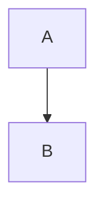

# zen — plugin system

Plugin API version: **1** (`apiVersion: 1`). Implemented by
`specs/core/plugins`; built-ins live in `internal/plugins/<id>`.

## What a plugin can do

A plugin takes part in the Go render pipeline (see PLAN.md). It can:

| Hook | Go interface | Use |
|---|---|---|
| source | `SourceHook` | rewrite markdown before parsing (includes, variables) |
| block | `BlockHook` | render a named fenced or container block (diagram, slides, poll) |
| inline | `InlineHook` | render a named inline directive (badge, icon) |
| html | `HTMLHook` | rewrite the final HTML before sanitising (table of contents) |
| assets | `AssetProvider` | ship CSS/JS files served at `/_plugins/<id>/…` and loaded only on pages that use the plugin |

Everything a plugin emits goes through the sanitiser. A plugin that needs
elements or attributes beyond the base policy declares them in its manifest.

```go
package plugins

const APIVersion = 1

type Manifest struct {
    ID          string            // "diagram"; [a-z][a-z0-9-]*
    Version     string            // SemVer of the plugin
    APIVersion  int
    Description string
    Default     bool              // enabled when no config mentions it
    Blocks      []string          // block names it owns: "mermaid", "diagram"
    Inlines     []string          // inline names it owns
    Allow       []AllowRule       // extra sanitiser rules: element + attributes
    Config      map[string]Option // option name -> type, default, description
}

type Plugin interface{ Manifest() Manifest }

type Context struct {
    Path   string         // workspace-relative path of the page
    Config map[string]any // this plugin's effective options for this page
}

type Block  struct{ Name, Body string; Attrs map[string]string; Fenced bool }
type Inline struct{ Name, Text string; Attrs map[string]string }

type SourceHook    interface{ Source(ctx Context, src []byte) ([]byte, error) }
type BlockHook     interface{ RenderBlock(ctx Context, b Block) (string, error) }
type InlineHook    interface{ RenderInline(ctx Context, i Inline) (string, error) }
type HTMLHook      interface{ HTML(ctx Context, html string) (string, error) }
type AssetProvider interface{ Assets() fs.FS; Entry() Assets } // Assets{CSS, JS []string}
```

A hook error never breaks the page: the block is replaced by an error box
(`<div class="zen-plugin-error">`) naming the plugin and the message.

## Syntax in markdown

Three forms, all resolved by name in the registry. An unknown or disabled
name falls back to plain rendering (a normal code block, or the literal text).

**Fenced block** — content is raw text, not markdown:

````markdown

````

**Container block** — content is markdown, may nest:

```markdown
:::slides{transition=fade}
# First slide
---
# Second slide
:::
```

**Inline directive:**

```markdown
Status: :badge[stable]{color=gray}
```

Attributes are `{key=value key2="two words" flag}`; a bare `flag` is `"true"`.
Names match `[a-z][a-z0-9-]*`. A colon not followed by a registered name is
left untouched, so normal prose (`note: this`) is never affected.

## Enabling, disabling, configuring

Order of precedence, last wins:

1. Plugin default (`Manifest.Default`, option defaults)
2. Global config — `<user config dir>/zen/config.yml`
   (macOS: `~/Library/Application Support/zen/config.yml`)
3. Workspace config — `.zen.yml` in the opened folder
4. Page frontmatter

```yaml
# config.yml or .zen.yml
version: 1
plugins:
  highlight: true                 # on, default options
  diagram: { theme: neutral }     # on, with options
  slides: false                   # off
```

```markdown
---
title: Architecture
plugins:
  diagram: false          # off for this page only
  highlight: { style: github }
---
```

The global `config.yml` (only) can also raise or lower the folder limits:

```yaml
limits:
  files: 5000       # markdown files (default 2000, max 100000)
  entries: 200000   # files and folders scanned (default 50000, max 5000000)
```

A `limits` key in `.zen.yml` is ignored with a warning, so a folder cannot
lift its own limits.

Pages can also tune their place in the navigation:

```markdown
---
slug: install                 # extra link target: [x](install), [x](/install#part)
nav:
  title: Setup                # label in the sidebar and breadcrumb (page heading unchanged)
  order: 2                    # position among siblings; ordered pages come first, ascending
  parent: guides/index.md     # show under this page (workspace path or slug)
  hidden: true                # leave out of the sidebar (still reachable by links)
---
```

- `slug`: lower-case letters, digits and `-`, parts separated by `/`, at most 100
  characters. A slug link resolves only when no real file matches. If two pages
  use the same slug, the first by path keeps it.
- `nav.parent` overrides the link-based placement. A missing parent, the page
  itself, or a parent that would create a cycle is ignored with a warning.
  Children of a hidden page are hidden too, unless they set their own `nav.parent`.
- Pages without these keys are placed by links as before. Invalid values are
  ignored and shown as page warnings.

`true` / `false` switch a plugin; a mapping switches it on and sets options.
Unknown plugin ids and unknown options produce a warning in the page
(`Page.warnings`), never an error.

## Built-in plugins

| ID | Version | Blocks | What it does |
|---|---|---|---|
| `highlight` | alpha | none (HTML hook over every `pre > code.language-*`) | syntax colouring in Go (chroma), CSS classes only |
| `diagram` | alpha | `mermaid`, `diagram` | emits a placeholder; a vendored mermaid script renders it in the page |
| `slides` | 0.2 | `slides` | splits a container on `---` into a slide deck |
| `polls` | 0.2 | `poll` | renders a list as a poll |

## External plugins (0.2, designed now)

A folder `<user config dir>/zen/plugins/<id>/` with `plugin.yml` (the
manifest above plus `entry: main.wasm`) and a WASM module run in wazero with
no filesystem and no network. Hooks are exported functions exchanging JSON.
External plugins cannot ship JavaScript unless the user grants the `script`
permission per plugin. The app never downloads plugin code.

## Security rules

- Sanitiser runs after every hook; `Allow` rules are additive and apply to the
  whole page while the plugin is enabled (alpha). They can never re-enable
  `script`, `style`, `iframe`, `object`, `embed`, `form`, `on*`, `style` or
  `srcdoc`. Scoping rules to the plugin's own subtree is a 0.2 item.
- No plugin receives file or network access through `Context`.
- Plugin JS (built-in only in alpha) is a static embedded file; no `eval`,
  no remote loading. Mermaid runs with `securityLevel: "strict"`.
