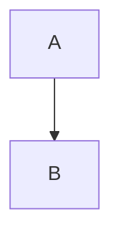

# zen — plugin system

Plugin API version: **1** (`apiVersion: 1`). Implemented by
`specs/core/plugins`; built-ins live in `internal/plugins/<id>`.

## What a plugin can do

A plugin takes part in the Go render pipeline (see PLAN.md). It can:

| Hook | Go interface | Use |
|---|---|---|
| source | `SourceHook` | rewrite markdown before parsing (includes, variables) |
| block | `BlockHook` | render a named fenced or container block (diagram, slides, poll) |
| inline | `InlineHook` | render a named inline directive (badge, icon) |
| html | `HTMLHook` | rewrite the final HTML before sanitising (table of contents) |
| assets | `AssetProvider` | ship CSS/JS files served at `/_plugins/<id>/…` and loaded only on pages that use the plugin |
| action | `ActionHook` | answer a request from the plugin's own frontend (`ctx.invoke`): JSON in, JSON out |
| stream | `StreamHook` | send output over time to the plugin's frontend (`ctx.stream`): a build log, a running program |

Everything a plugin emits goes through the sanitiser. A plugin that needs
elements or attributes beyond the base policy declares them in its manifest.

```go
package plugins

const APIVersion = 1

type Manifest struct {
    ID          string            // "diagram"; [a-z][a-z0-9-]*
    Version     string            // SemVer of the plugin
    APIVersion  int
    Description string
    Default     bool              // enabled when no config mentions it
    Blocks      []string          // block names it owns: "mermaid", "diagram"
    Inlines     []string          // inline names it owns
    Allow       []AllowRule       // extra sanitiser rules: element + attributes
    Config      map[string]Option // option name -> type, default, description, scope
}

type Plugin interface{ Manifest() Manifest }

type Context struct {
    Path      string         // workspace-relative path of the page
    Config    map[string]any // this plugin's effective options for this page
    DataDir   string         // the plugin's writable folder (actions and streams; same place as ZEN_DATA_DIR)
    Workspace string         // root of the open folder (actions and streams)
}

type Block  struct{ Name, Body string; Attrs map[string]string; Fenced bool }
type Inline struct{ Name, Text string; Attrs map[string]string }

type SourceHook    interface{ Source(ctx Context, src []byte) ([]byte, error) }
type BlockHook     interface{ RenderBlock(ctx Context, b Block) (string, error) }
type InlineHook    interface{ RenderInline(ctx Context, i Inline) (string, error) }
type HTMLHook      interface{ HTML(ctx Context, html string) (string, error) }
type AssetProvider interface{ Assets() fs.FS; Entry() Assets } // Assets{CSS, JS []string}

// For the plugin's frontend (see "Frontend" below). Built-in plugins use the same ctx as external ones.
type ActionHook interface {
    Action(ctx Context, payload []byte) ([]byte, error)
}
type StreamHook interface { // emit is called in order; return when done; stop when c is cancelled
    Stream(c context.Context, ctx Context, payload []byte, emit func(chunk []byte)) error
}
```

`Option.Type` is `string`, `bool`, `int`, `map` (names to strings, a
`map[string]string`) or `list` (strings, a `[]string`). An option with
`Scope: "user"` is read from the user's global `config.yml` only; the same
option in `.zen.yml` or frontmatter is ignored with a page warning. Use it for
anything a folder must not be able to widen, such as the container images a
sandbox plugin may run.

A built-in plugin that implements `ActionHook` or `StreamHook` can be called
from its frontend like an external one, as long as it is switched on.

A hook error never breaks the page: the block is replaced by an error box
(`<div class="zen-plugin-error">`) naming the plugin and the message.

## Syntax in markdown

Three forms, all resolved by name in the registry. An unknown or disabled
name falls back to plain rendering (a normal code block, or the literal text).

**Fenced block** — content is raw text, not markdown:

````markdown

````

**Container block** — content is markdown, may nest:

```markdown
:::slides{transition=fade}
# First slide
---
# Second slide
:::
```

**Inline directive:**

```markdown
Status: :badge[stable]{color=gray}
```

Attributes are `{key=value key2="two words" flag}`; a bare `flag` is `"true"`.
Names match `[a-z][a-z0-9-]*`. A colon not followed by a registered name is
left untouched, so normal prose (`note: this`) is never affected.

## Enabling, disabling, configuring

Order of precedence, last wins:

1. Plugin default (`Manifest.Default`, option defaults)
2. Global config — `<user config dir>/zen/config.yml`
   (macOS: `~/Library/Application Support/zen/config.yml`)
3. Workspace config — `.zen.yml` in the opened folder
4. Page frontmatter

```yaml
# config.yml or .zen.yml
version: 1
plugins:
  codeblock: true                 # on, default options
  diagram: { theme: neutral }     # on, with options
  slides: false                   # off
```

```markdown
---
title: Architecture
plugins:
  diagram: false          # off for this page only
  codeblock: { style: github }
---
```

The global `config.yml` (only) can also raise or lower the folder limits:

```yaml
limits:
  files: 5000       # markdown files (default 2000, max 100000)
  entries: 200000   # files and folders scanned (default 50000, max 5000000)
```

A `limits` key in `.zen.yml` is ignored with a warning, so a folder cannot
lift its own limits.

Prose linting (Vale) is on by default when Vale is available. Turn it off for a
page, a folder or everywhere with the reserved switch `lint` (no warning):

```yaml
plugins:
  lint: false
```

A `.vale.ini` in the folder replaces zen's default Vale config (spelling plus
Vale's built-in rules).

Pages can also tune their place in the navigation:

```markdown
---
slug: install                 # extra link target: [x](install), [x](/install#part)
nav:
  title: Setup                # label in the sidebar and breadcrumb (page heading unchanged)
  order: 2                    # position among siblings; ordered pages come first, ascending
  parent: guides/index.md     # show under this page (workspace path or slug)
  hidden: true                # leave out of the sidebar (still reachable by links)
---
```

- `slug`: lower-case letters, digits and `-`, parts separated by `/`, at most 100
  characters. A slug link resolves only when no real file matches. If two pages
  use the same slug, the first by path keeps it.
- `nav.parent` overrides the link-based placement. A missing parent, the page
  itself, or a parent that would create a cycle is ignored with a warning.
  Children of a hidden page are hidden too, unless they set their own `nav.parent`.
- Pages without these keys are placed by links as before. Invalid values are
  ignored and shown as page warnings.

`true` / `false` switch a plugin; a mapping switches it on and sets options.
Unknown plugin ids and unknown options produce a warning in the page
(`Page.warnings`), never an error.

## Built-in plugins

| ID | Version | Blocks | What it does |
|---|---|---|---|
| `codeblock` | alpha | none (HTML hook over every `pre > code`) | syntax colouring in Go (chroma, CSS classes only), plus Copy and Wrap buttons in each block |
| `diagram` | alpha | `mermaid`, `diagram` | emits a placeholder; a vendored mermaid script renders it in the page |
| `slides` | 0.2 | `slides` | splits a container on `---` into a slide deck |
| `polls` | 0.2 | `poll` | renders a list as a poll |

## Writing your own plugin (external plugins)

A plugin is a **folder with a `plugin.yml`**. zen looks in two places:

| Where | For |
|---|---|
| `<folder>/.zen/plugins/<id>/` | plugins that travel with a folder of documents |
| `<user config dir>/zen/plugins/<id>/` (macOS: `~/Library/Application Support/zen/plugins/`) | your own plugins, for every folder |

A plugin can have any mix of three parts:

| Part | What it is | Use it for |
|---|---|---|
| **backend** | any program (script or binary) zen runs when a page renders | turning a block into HTML, calling a tool (`dot`, `bc`, `container`) |
| **frontend** | JavaScript and CSS loaded on pages that use the plugin | interactive blocks, layouts, anything that reacts to clicks |
| **tool** | a backend whose command is an existing program on the Mac | no code at all: the block's text is its input, its output is shown |

### plugin.yml

```yaml
id: note                      # [a-z][a-z0-9-]*, must equal the folder name
version: 0.1.0                # SemVer
apiVersion: 1
description: Callout boxes
default: true                 # on unless config switches it off (also when omitted)

blocks: [note, warning]       # ```note fences and :::note containers
inlines: [badge]              # :badge[text]{attrs}
layouts: [slides]             # pages with frontmatter `layout: slides`

options:                      # read from config / frontmatter `plugins.note.*`
  icon: { type: bool, default: true, description: Show an icon }
  images: { type: map, scope: user }   # map (string to string) and list (strings) are also types;
                                       # scope: user = only the global config.yml may set it

allow:                        # extra HTML the sanitiser keeps for this plugin
  - { element: div, attrs: [class] }

backend:
  command: ["./note.sh"]      # relative to the plugin folder, or a program on PATH
  hooks: [block, inline]      # any of: source, block, inline, html, action, stream
  output: html                # html (default) or text (escaped and shown in <pre>)
  timeout: 5s                 # default 5s, at most 60s; with the stream hook: default 60s, at most 10m

frontend:
  js: [note.js]               # ES modules, loaded only on pages that use the plugin
  css: [note.css]
```

### Backend: one program, plain input and output

zen starts `command` once per call, in the plugin folder, with **input on
stdin**, the **result on stdout**, and everything else in environment
variables. Exit code 0 means success; anything else shows stderr in an error
box in place of the block (the page still renders).

| `ZEN_HOOK` | stdin | stdout |
|---|---|---|
| `block` | the block's body (raw text) | HTML for the block |
| `inline` | the text in `[...]` | HTML for the span |
| `source` | the page's markdown | markdown |
| `html` | the page's HTML | HTML |
| `action` | JSON sent by the plugin's frontend (`ctx.invoke`) | JSON returned to it |
| `stream` | JSON sent by the plugin's frontend (`ctx.stream`) | forwarded to the frontend line by line, as it is printed |

A `stream` call ends when the program exits: exit code 0 is success, anything
else is reported to the frontend with the first lines of stderr. It is cut at
4 MB of output (error `output limit`), when its timeout passes, when the
frontend cancels it (the whole process group is killed) and when the folder
changes or zen quits. At most 4 streams run at once. `timeout` for a plugin
with the `stream` hook is the stream's limit; its other hooks keep the 60 s
cap.

| Variable | Value |
|---|---|
| `ZEN_HOOK`, `ZEN_PLUGIN`, `ZEN_API` | hook name, plugin id, `1` |
| `ZEN_NAME` | block or inline name (`note`) |
| `ZEN_FENCED` | `1` for a ``` fence, `0` for a `:::` container |
| `ZEN_PAGE` | page path inside the folder (`guides/install.md`) |
| `ZEN_ATTR_<KEY>` | each `{key=value}` attribute, key upper-cased, `-` → `_` |
| `ZEN_ATTRS_JSON`, `ZEN_CONFIG_JSON` | all attributes / this plugin's options as JSON |
| `ZEN_CONFIG_<KEY>` | each option (a `map` or `list` as JSON) |
| `ZEN_WORKSPACE`, `ZEN_PLUGIN_DIR`, `ZEN_DATA_DIR` | folder root, plugin folder, a writable data folder for this plugin |

The environment is otherwise minimal (`PATH`, `HOME`, `TMPDIR`, `LANG`). Output
is capped at 2 MB. Whatever the program prints is sanitised like all HTML.

A whole plugin in a shell script:

```sh
#!/bin/sh
# .zen/plugins/note/note.sh — renders :::note{title="..."} containers
title="${ZEN_ATTR_TITLE:-Note}"
printf '<div class="note"><strong>%s</strong>' "$title"
sed -e 's/&/\&amp;/g' -e 's/</\&lt;/g'      # body from stdin, escaped
printf '</div>'
```

A **tool** plugin needs no code. This one evaluates ```` ```calc ```` blocks with `bc`:

```yaml
id: calc
version: 0.1.0
apiVersion: 1
blocks: [calc]
backend: { command: ["bc", "-l"], hooks: [block], output: text }
```

### Frontend: mount on your blocks

Every block, inline or layout a plugin owns is wrapped by zen:

```html
<div data-zen-plugin="quiz" data-zen-name="quiz" data-zen-attrs='{"id":"q1"}'> … </div>
```

Inside is the backend's HTML or, for a plugin without a `block` hook, the
content itself: a `:::` container's markdown rendered to HTML, or a fence's
text in `<pre class="zen-plugin-source">`. The plugin's script registers
itself and zen calls `mount` for each wrapper, again after every re-render:

```js
// .zen/plugins/counter/counter.js
zen.register("counter", {
  async mount(el, ctx) {
    let n = (await ctx.storage.get("count")) ?? 0;
    const b = document.createElement("button");
    const draw = () => (b.textContent = `Clicked ${n} times`);
    b.onclick = async () => { n++; draw(); await ctx.storage.set("count", n); };
    draw();
    el.replaceChildren(b);
    return () => b.remove();          // optional clean-up
  },
});
```

| `ctx` | |
|---|---|
| `ctx.id`, `ctx.kind`, `ctx.name` | plugin id; `"block"`, `"inline"` or `"layout"`; the block name |
| `ctx.attrs` | the `{key=value}` attributes |
| `ctx.page` | `{ path, title }` |
| `ctx.storage.get(key)` / `.set(key, value)` | JSON values kept per plugin and per folder, on this Mac (1 MB per plugin) |
| `ctx.storage.keys(prefix?)` | the stored keys (starting with `prefix`), sorted |
| `ctx.invoke(payload)` | runs the backend with `ZEN_HOOK=action`; resolves to the JSON it prints |
| `ctx.stream(payload, onChunk)` | runs the backend with `ZEN_HOOK=stream` (or a built-in's `StreamHook`); `onChunk(text)` gets each line in order. Returns `{ done, cancel() }`: `done` resolves when it ends and rejects with the error text (`cancelled` after `cancel()`). Streams a block started are cancelled when it unmounts |
| `ctx.navigate(path, anchor?)` | open another page |
| `ctx.anchor()` | the current page's anchor (`""` when none) |
| `ctx.onAnchor(fn)` | `fn(anchor)` when the anchor changes without a reload (a link to another heading of the same page); returns a remover; removed on unmount |
| `ctx.badge(path, text)` | sets a short label (12 characters at most; `null` clears) shown muted after that page's title in the sidebar, until the window closes |

```js
// stream a log into a <pre>
const log = document.createElement("pre");
el.replaceChildren(log);
const run = ctx.stream({ target: "build" }, (line) => log.append(line + "\n"));
run.done.catch((err) => log.append(`stopped: ${err.message}\n`));
```

Print: File › Print… (⌘P) prints the open page; zen hides the sidebar, header
and panels and uses the full page width. A plugin can add its own rules in an
`@media print` block of its CSS (for instance one slide per sheet).

### Layouts

A plugin that lists `layouts: [slides]` takes over pages whose frontmatter
says `layout: slides`. zen renders the page as usual and wraps it in
`<div data-zen-plugin="…" data-zen-layout="slides">`; the plugin's frontend
(`ctx.kind === "layout"`) rearranges it, e.g. one slide per `<hr>`.

### Trust

Plugins run programs and scripts, so **zen asks before using a plugin for
the first time**, naming what it will run. The answer is remembered for that
exact version of the plugin's files (a change asks again) in
`<user config dir>/zen/trusted-plugins.yml`. Answering Block is remembered too, so zen does not
ask again until the plugin changes. Blocked plugins render as plain markdown
with a note on the page. Settings (the cog) lists every plugin with
Allow / Block.

## Security rules

- Sanitiser runs after every hook; `Allow` rules are additive and apply to the
  whole page while the plugin is enabled (alpha). They can never re-enable
  `script`, `style`, `iframe`, `object`, `embed`, `form`, `on*`, `style` or
  `srcdoc`. Scoping rules to the plugin's own subtree is a 0.2 item.
- No plugin receives file or network access through `Context`.
- A stream or action reaches only the plugin that is switched on and, for an
  external plugin, allowed; stream ids are random and the page delivers a
  stream's output only to the block that started it. Options with
  `scope: user` cannot be set by a folder or a page.
- Built-in plugin JS is a static embedded file; no `eval`, no remote loading.
  Mermaid runs with `securityLevel: "strict"`.
- External plugins run only after the user allowed that exact set of files
  (see Trust). Their backend gets a minimal environment, a timeout and an
  output cap; their HTML is sanitised like any other; their scripts are served
  from the app's own origin, so the page's `script-src 'self'` still holds.
