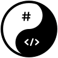

# Markdown showcase

Everything zen renders, in one page.

## Text

Plain, **bold**, *italic*, ~~struck~~, `inline code`, and a footnote.[^1]
Angle brackets stay visible in titles and text: `List<T>`, 3 &lt; 4.

> A quote can hold **markdown** too.

## Lists

- A bullet
  - nested
1. First
2. Second
- [x] A done task
- [ ] An open task

## Table

| Left | Center | Right |
|:---|:---:|---:|
| a | b | 1 |
| longer cell | c | 22 |

## Images

## Links

An autolink: https://commonmark.org, an [inline link](../README.md) and
[a reference link][guide].

[guide]: ../README.md

---

[^1]: Footnotes collect at the bottom.
