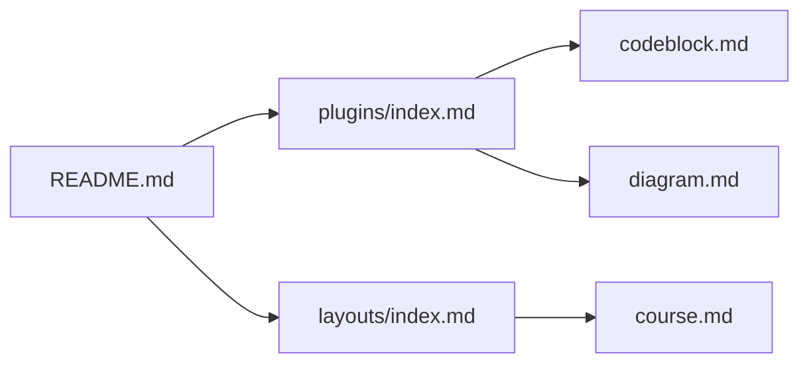

# Learn by doing

Work through the steps in order. Tick the boxes to unlock the next step. Your
progress is saved on this Mac. The steps use the other plugins too, so a course
can hold code, diagrams and quizzes as well as checklists.

If a step isn't for you, press **Skip step** to move on; you can come back to it later.

## Open a folder

Zenmark reads a folder of markdown files. Open one from the File menu, or run
it from a terminal:

```sh
cd ~/Notes
zenmd .
```

:::check
- [ ] I opened a folder in Zenmark
- [ ] I can see its pages in the sidebar
:::

## How the sidebar is built

The sidebar isn't a list you keep by hand. Zenmark follows the links between
your pages, starting at `README.md`, and a page sits under the first page that
links to it:



:::check
- [ ] I found this page under Layouts in the sidebar
- [ ] I followed a link inside a page
:::

## Give a page some frontmatter

A page can set its title and layout in a block of YAML at the top. This is the
frontmatter of this page:

```yaml
---
title: Learn by doing
layout: course
layoutOptions: { id: getting-started }
---
```

Copy the block with the **Copy** button on it, then try it on a page of your
own.

:::check
- [ ] I copied the frontmatter
- [ ] I gave one of my pages a title
:::

## Check a page

Open the Inspector from the button in the top bar. Page Info
shows what the page is made of, and Problems lists its broken links and missing
images.

:::check
- [ ] I opened the Inspector
- [ ] I looked at the Problems tab
:::

## Test yourself

:::quiz{id=course-check title="What did you learn?" pass=60}
1. Where does the sidebar start?
   - ( ) At the first file in the folder
   - (x) At README.md
   - ( ) At index.md
   > It follows the links from README.md.
2. Which of these can sit inside a course step?
   - [x] A diagram
   - [x] A quiz
   - [x] Code with a Copy button
   - [ ] A second course
   > A page has one layout, so a course can't hold another course.
3. Which key in the frontmatter picks a layout? = layout
:::

:::check
- [ ] I checked my answers
:::

## Rate this course

How did it go? Pick the stars, and Zenmark keeps your rating on this Mac.

:::rating{id=learn-by-doing title="How was this course?" labels="Poor|Fair|Good|Very good|Excellent"}
:::

## Done

You finished the course. Press Finish to mark it done, or Reset to start over.
