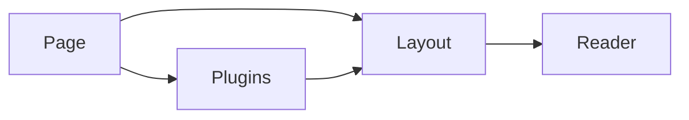

# The wide layout

Uses the whole pane instead of the reading column. It suits wide tables,
diagrams and dashboards.

```yaml
---
layout: wide
---
```

| Layout | Made of | Reads | Options | Best for | Notes |
|---|---|---|---|---|---|
| article | nothing | nothing | none | reading | the default reading column |
| docs | template, CSS | nothing | `toc` | documentation | rail and neighbour links |
| post | template, CSS | date, author, cover, tags | reading | blog posts | cover and meta line |
| landing | template, CSS | tagline, cover | cards | a folder home | cards for the pages below |
| wide | template, CSS | nothing | none | tables, diagrams | no reading column |
| handout | template, CSS | date, author | paper | one-pagers | a paper sheet |
| slides | CSS, script | nothing | ratio, transition | talks | one slide at a time |


