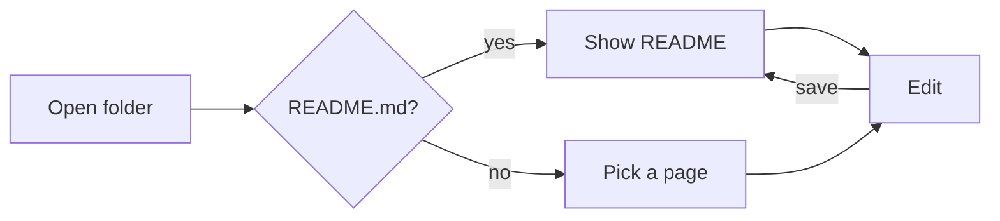
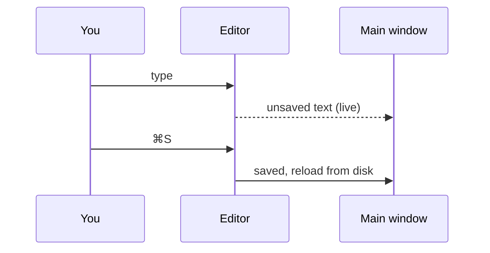

---
plugins:
  diagram: { theme: neutral }
---
# Diagrams

Write a ` ```mermaid ` block and zen draws it. Diagrams follow the light or
dark theme.

## Flowchart



## Sequence



## When a diagram is wrong

The source stays visible with mermaid's error message under it:

```mermaid
graph TD
  A --> 
```

## Options

```yaml
plugins:
  diagram: { theme: neutral }   # neutral (default), default or dark
```
