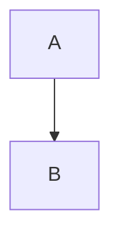

# Plugin syntax

Plugins are called from markdown in three ways. A name that no enabled plugin
owns renders as plain markdown, so these never break a page.

## Fenced block

The content is raw text, given to the plugin as is:

````markdown

````

## Container block

The content is markdown and can nest. A plugin with a backend gets it as raw
text; without one, zen renders the markdown and the plugin's script works on
the result.

```markdown
:::note{title="Remember"}
Containers start and end with three colons.
:::
```

:::note{title="Remember"}
Containers start and end with three colons.
:::

The box comes from `note`, one of the plugins in this folder's `.zen/plugins/`
(see [Writing your own plugin](writing-plugins.md)). Until you allow it, the
block shows as plain text.

## Inline

```markdown
Status: :badge[stable]{color=gray}
```

Status: :badge[stable]{color=gray}

No plugin in this folder owns `badge`, so the line above shows as it was typed.

Attributes are `{key=value key2="two words" flag}`. Ordinary text with colons,
like `note: this` or 10:30, is never treated as a plugin call.
