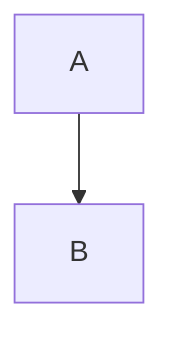

# Plugin syntax

Plugins are called from markdown in three ways. A name that no enabled plugin
owns renders as plain markdown, so these never break a page.

## Fenced block

The content is raw text, given to the plugin as is:

````markdown

````

## Container block

The content is markdown and can nest:

```markdown
:::note{title="Remember"}
Containers hold **markdown**.
:::
```

:::note{title="Remember"}
No built-in plugin owns `note` yet, so this block shows as plain text.
:::

## Inline

```markdown
Status: :badge[stable]{color=gray}
```

Status: :badge[stable]{color=gray}

Attributes are `{key=value key2="two words" flag}`. Ordinary text with colons,
like `note: this` or 10:30, is never treated as a plugin call.
